# SỔ TAY HƯỚNG DẪN SỬ DỤNG PHẦN MỀM CHẤM CÔNG SUPERBRAIN
*(Tài liệu Hướng dẫn Sử dụng Chi tiết Theo Từng Vai Trò - Ngôn ngữ Đơn giản, Dễ hiểu, Sắp xếp Theo Trình tự Thực tế)*

---

## LỜI MỞ ĐẦU

Chào mừng bạn đến với **Hệ Thống Chấm Công & Quản Lý Nghỉ Phép Superbrain**!

Tài liệu này được biên soạn bởi Ban Quản Lý Dự Án nhằm giúp toàn thể cán bộ nhân viên, các thầy cô giáo, các cấp quản lý và bộ phận nhân sự có thể dễ dàng sử dụng phần mềm ngay từ lần đầu tiên. Toàn bộ nội dung đã được đơn giản hóa: **không dùng thuật ngữ kỹ thuật phức tạp**, sắp xếp các tính năng theo đúng **trình tự việc nào làm trước - việc nào làm sau**, kèm hình ảnh thực tế và các mẹo thao tác để tránh nhầm lẫn.

---

## MỤC LỤC TỔNG QUAN

1. [CHƯƠNG 1: GIỚI THIỆU TỔNG QUAN HỆ THỐNG](#chương-1-giới-thiệu-tổng-quan-hệ-thống)
2. [CHƯƠNG 2: HƯỚNG DẪN DÀNH CHO NHÂN VIÊN & NHÂN SỰ TỰ CHẤM CÔNG (GIÁO VIÊN, NHÂN SỰ THỬ VIỆC & VĂN PHÒNG)](#chương-2-hướng-dẫn-dành-cho-nhân-viên--nhân-sự-tự-chấm-công-giáo-viên-nhân-sự-thử-việc--văn-phòng)
   - 2.1. [Việc làm 1 lần đầu tiên: Đăng nhập & Đăng ký thiết bị cá nhân](#21-việc-làm-1-lần-đầu-tiên-đăng-nhập--đăng-ký-thiết-bị-cá-nhân)
   - 2.2. [Việc làm mỗi ngày: Bấm điểm danh Vào làm & Ra về](#22-việc-làm-mỗi-ngày-bấm-điểm-danh-vào-làm--ra-về)
   - 2.3. [Việc làm định kỳ: Xem lại ngày công và số ngày phép còn lại](#23-việc-làm-định-kỳ-xem-lại-ngày-công-và-số-ngày-phép-còn-lại)
   - 2.4. [Khi có việc đột xuất: Làm đơn xin nghỉ phép](#24-khi-có-việc-đột-xuất-làm-đơn-xin-nghỉ-phép)
   - 2.5. [Khi quên bấm giờ hoặc đi công tác ngoài: Làm đơn báo bổ sung công (giải trình)](#25-khi-quên-bấm-giờ-hoặc-đi-công-tác-ngoài-làm-đơn-báo-bổ-sung-công-giải-trình)
   - 2.6. [Dành cho nhân sự thử việc & bán thời gian: Đăng ký lịch làm việc](#26-dành-cho-nhân-sự-thử-việc--bán-thời-gian-đăng-ký-lịch-làm-việc)
   - 2.7. [Xem thông báo phản hồi từ Quản lý và Nhân sự](#27-xem-thông-báo-phản-hồi-từ-quản-lý-và-nhân-sự)
3. [CHƯƠNG 3: HƯỚNG DẪN DÀNH CHO TRƯỞNG BỘ PHẬN / QUẢN LÝ CƠ SỞ](#chương-3-hướng-dẫn-dành-cho-trưởng-bộ-phận--quản-lý-cơ-sở)
   - 3.1. [Đầu ngày: Xem danh sách nhân viên đi làm hôm nay](#31-đầu-ngày-xem-danh-sách-nhân-viên-đi-làm-hôm-nay)
   - 3.2. [Khi có đơn gửi lên: Duyệt đơn xin nghỉ phép của nhân viên](#32-khi-có-đơn-gửi-lên-duyệt-đơn-xin-nghỉ-phép-của-nhân-viên)
   - 3.3. [Khi có đơn gửi lên: Duyệt đơn báo bổ sung công của nhân viên](#33-khi-có-đơn-gửi-lên-duyệt-đơn-báo-bổ-sung-công-của-nhân-viên)
   - 3.4. [Cuối tháng: Rà soát lại công của toàn bộ bộ phận trước khi gửi Nhân sự](#34-cuối-tháng-rà-soát-lại-công-của-toàn-bộ-bộ-phận-trước-khi-gửi-nhân-sự)
4. [CHƯƠNG 4: HƯỚNG DẪN DÀNH CHO BỘ PHẬN NHÂN SỰ (HR / TÍNH LƯƠNG)](#chương-4-hướng-dẫn-dành-cho-bộ-phận-nhân-sự-hr--tính-lương)
   - 4.1. [Hàng ngày / Trong tháng: Theo dõi các lượt bấm giờ bị báo lỗi để nhắc nhở](#41-hàng-ngày--trong-tháng-theo-dõi-các-lượt-bấm-giờ-bị-báo-lỗi-để-nhắc-nhở)
   - 4.2. [Trong tháng: Quản lý ngày nghỉ toàn công ty & Nạp danh sách nghỉ từ Excel](#42-trong-tháng-quản-lý-ngày-nghỉ-toàn-công-ty--nạp-danh-sách-nghỉ-từ-excel)
   - 4.3. [Cuối kỳ: Quy trình Tính công tự động 1-Lần-Bấm](#43-cuối-kỳ-quy-trình-tính-công-tự-động-1-lần-bấm)
   - 4.4. [Cuối kỳ: Nạp thêm dữ liệu từ máy bấm vân tay tại cửa (nếu có)](#44-cuối-kỳ-nạp-thêm-dữ-liệu-từ-máy-bấm-vân-tay-tại-cửa-nếu-có)
   - 4.5. [Cuối kỳ: Sửa công trực tiếp bằng tay & Nút Hoàn tác (Undo) nếu lỡ sửa nhầm](#45-cuối-kỳ-sửa-công-trực-tiếp-bằng-tay--nút-hoàn-tác-undo-nếu-lỡ-sửa-nhầm)
   - 4.6. [Cuối kỳ: Chốt bảng công và Xuất file Excel gửi kế toán trả lương](#46-cuối-kỳ-chốt-bảng-công-và-xuất-file-excel-gửi-kế-toán-trả-lương)
5. [CHƯƠNG 5: HƯỚNG DẪN DÀNH CHO QUẢN TRỊ VIÊN HỆ THỐNG (ADMIN)](#chương-5-hướng-dẫn-dành-cho-quản-trị-viên-hệ-thống-admin)
   - 5.1. [Cài đặt ban đầu: Tạo danh sách Cơ sở / Chi nhánh mới](#51-cài-đặt-ban-đầu-tạo-danh-sách-cơ-sở--chi-nhánh-mới)
   - 5.2. [Cài đặt ban đầu: Cài đặt Vị trí và Tên Wifi cho cơ sở](#52-cài-đặt-ban-đầu-cài-đặt-vị-trí-và-tên-wifi-cho-cơ-sở)
   - 5.3. [Cài đặt ban đầu: Cài đặt Quy định giờ làm việc](#53-cài-đặt-ban-đầu-cài-đặt-quy-định-giờ-làm-việc)
   - 5.4. [Khi có nhân sự mới: Tạo tài khoản và phân quyền vai trò](#54-khi-có-nhân-sự-mới-tạo-tài-khoản-và-phân-quyền-vai-trò)
   - 5.5. [Hỗ trợ hàng ngày: Đổi mật khẩu giúp nhân viên](#55-hỗ-trợ-hàng-ngày-đổi-mật-khẩu-giúp-nhân-viên)
   - 5.6. [Hỗ trợ hàng ngày: Mở khóa đổi máy khi nhân viên mua điện thoại/máy tính mới](#56-hỗ-trợ-hàng-ngày-mở-khóa-đổi-máy-khi-nhân-viên-mua-điện-thoạimáy-tính-mới)
   - 5.7. [Cài đặt thương hiệu & Theo dõi nhật ký hệ thống](#57-cài-đặt-thương-hiệu--theo-dõi-nhật-ký-hệ-thống)
6. [CHƯƠNG 6: 10 ĐIỀU QUAN TRỌNG NHẤT BẮT BUỘC PHẢI NHỚ](#chương-6-10-điều-quan-trọng-nhất-bắt-buộc-phải-nhớ)
7. [CHƯƠNG 7: GIẢI ĐÁP THẮC MẮC & XỬ LÝ NHANH CÁC TÌNH HUỐNG THƯỜNG GẶP](#chương-7-giải-đáp-thắc-mắc--xử-lý-nhanh-các-tình-huống-thường-gặp)

---

# CHƯƠNG 1: GIỚI THIỆU TỔNG QUAN HỆ THỐNG

Phần mềm Chấm công Superbrain được thiết kế giúp việc ghi nhận thời gian làm việc hàng ngày trở nên **nhanh gọn, chính xác và tiện lợi** cho tất cả mọi người.

### 4 Vai trò (Role) trong hệ thống:
1. **Nhân viên & Nhân sự tự chấm công (Giáo viên, nhân sự thử việc, nhân sự cơ sở & văn phòng)**: Chủ động bấm điểm danh giờ vào/ra trên máy tính hoặc điện thoại, đăng ký lịch làm việc (dành cho nhân sự thử việc/part-time), xem lại ngày công của mình, làm đơn xin nghỉ phép hoặc báo bổ sung công khi quên bấm giờ.
2. **Quản lý (Trưởng bộ phận, Quản lý cơ sở)**: Theo dõi nhân viên đi làm hôm nay, xem và duyệt các đơn xin nghỉ phép, duyệt đơn báo bổ sung công của cấp dưới.
3. **Nhân sự (HR / Tính lương)**: Rà soát các trường hợp bấm giờ bị lỗi, quản lý ngày nghỉ toàn công ty, bấm tính công tự động cuối tháng, sửa tay khi cần và xuất bảng lương.
4. **Quản trị viên (Admin)**: Khai báo cơ sở, cài đặt vị trí và Wifi văn phòng, cấp tài khoản cho người mới và mở khóa khi nhân viên đổi máy tính hoặc điện thoại mới.

---

# CHƯƠNG 2: HƯỚNG DẪN DÀNH CHO NHÂN VIÊN & NHÂN SỰ TỰ CHẤM CÔNG (GIÁO VIÊN, NHÂN SỰ THỬ VIỆC & VĂN PHÒNG)

Để thuận tiện nhất, quy trình sử dụng của bạn được sắp xếp từ **việc làm đầu tiên** cho đến **công việc hàng ngày** và **các việc phát sinh khi cần**:

```
[BƯỚC 1] Đăng nhập & Đăng ký thiết bị (Chỉ làm 1 lần)
    ⬇
[BƯỚC 2] Bấm Vào làm sáng & Bấm Ra về chiều (Mỗi ngày)
    ⬇
[BƯỚC 3] Xem lại lịch sử công và phép năm (Bất cứ lúc nào)
    ⬇
[BƯỚC 4] Làm đơn Nghỉ phép hoặc Báo bổ sung công (Khi có việc đột xuất)
    ⬇
[BƯỚC 5] Xem Chuông thông báo phản hồi (Nhận kết quả từ Sếp)
```

---

## 2.1. Việc làm 1 lần đầu tiên: Đăng nhập & Đăng ký thiết bị cá nhân

Để bảo đảm tính công bằng và tránh việc bấm giờ hộ nhau, **mỗi người chỉ được sử dụng đúng 1 máy tính hoặc 1 chiếc điện thoại chính chủ của mình**.

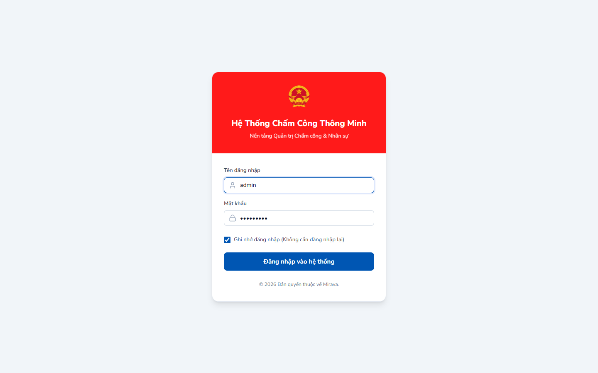

### Các bước thực hiện:
1. Mở trình duyệt web trên máy tính hoặc điện thoại (Google Chrome, Cốc Cốc, Safari).
2. Nhập địa chỉ trang web chấm công của công ty (Ví dụ: `http://chamcong.superbrain.vn` hoặc link do phòng Nhân sự gửi).
3. Nhập **Tên đăng nhập** (Mã nhân viên của bạn, ví dụ: `nv01`).
4. Nhập **Mật khẩu** (Mật khẩu được cấp ban đầu, ví dụ: `Admin@123` hoặc mật khẩu bạn đã tự đổi).
5. Tích chọn ô **"Ghi nhớ đăng nhập"**: Giúp bạn không phải gõ lại mật khẩu vào mỗi sáng mai.
6. Bấm nút xanh **"Đăng nhập vào hệ thống"**.

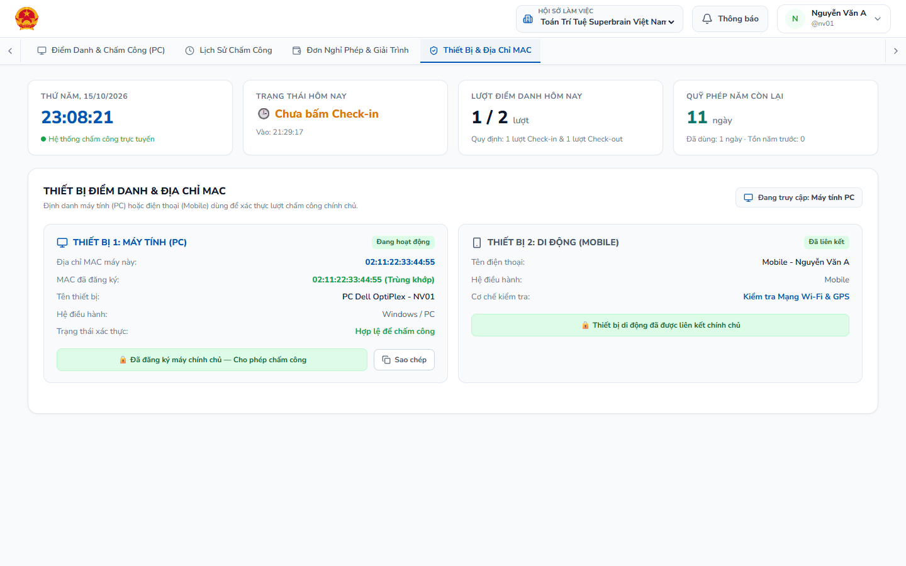

### Đăng ký máy của bạn:
- Vào menu **"Cài đặt thiết bị"** (hoặc *Thiết Bị & Địa Chỉ Máy*).
- **Nếu bạn đang dùng Máy tính làm việc (PC/Laptop)**:
  - Phần mềm rất thông minh: Tự biết bạn đang mở bằng máy tính. Nút bấm điện thoại sẽ tự khóa lại để bạn không bấm nhầm.
  - Bạn chỉ cần bấm nút: **"Đăng ký thiết bị PC này"**. Màn hình hiện thông báo xanh: *Đăng ký thành công!*
- **Nếu bạn đang dùng Điện thoại**:
  - Trình duyệt sẽ hỏi: *"Trang web muốn biết vị trí của bạn"*, bạn hãy bấm **CHO PHÉP (Allow)**.
  - Bấm nút: **"Đăng ký thiết bị di động này"**.

> [!WARNING]
> **LƯU Ý RẤT QUAN TRỌNG**: Tuyệt đối **KHÔNG mượn máy tính hay điện thoại của đồng nghiệp** để bấm đăng ký hộ tài khoản của mình. Một máy chỉ nhận một người; nếu bạn bấm vào máy của bạn mình, bạn sẽ làm máy đó bị nhận sai chủ và đồng nghiệp của bạn sẽ không chấm công được!

---

## 2.2. Việc làm mỗi ngày: Bấm điểm danh Vào làm & Ra về

Mỗi ngày đi làm, bạn chỉ cần mở phần mềm và thực hiện đúng 2 lần bấm:
- **Buổi sáng (hoặc đầu ca làm)**: Bấm Vào làm (Check-in).
- **Buổi chiều (hoặc hết ca làm)**: Bấm Ra về (Check-out).

---

### Cách 1: Chấm công trên Máy tính (PC / Laptop)
*Phù hợp cho các bạn ngồi làm việc cố định tại văn phòng cơ sở.*

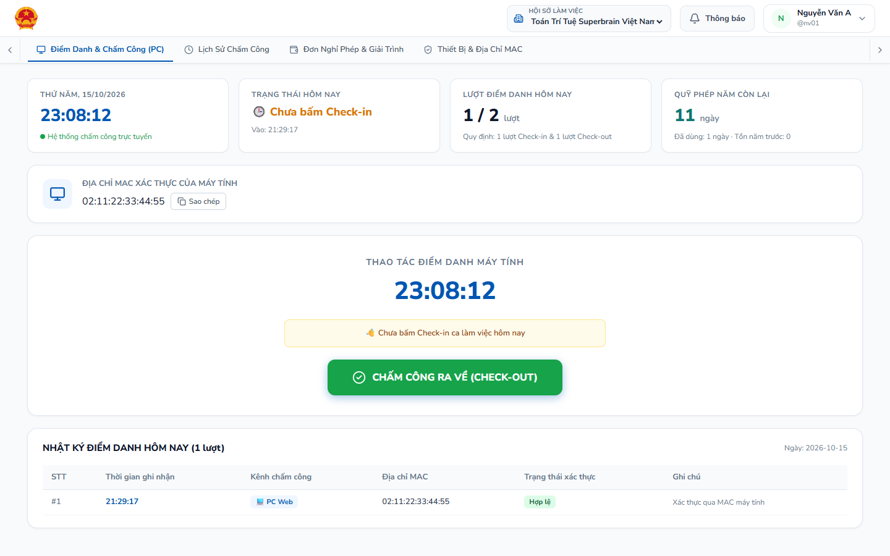

- **Nguyên lý rất đơn giản**: Máy tính văn phòng đã được nhận diện là máy của bạn. Bạn **không cần** bận tâm về sóng Wifi hay định vị GPS.
- **Thao tác**:
  1. Mở trang web chấm công trên máy tính quen thuộc của bạn.
  2. Màn hình hiển thị dòng chữ xanh: **Thiết bị hợp lệ**.
  3. Bấm nút màu xanh: **"CHẤM CÔNG VÀO (CHECK-IN)"** vào buổi sáng.
  4. Hết giờ làm việc, bấm nút: **"CHẤM CÔNG RA VỀ (CHECK-OUT)"**.
  5. Màn hình báo âm thanh nhẹ và thông báo màu xanh: **"Chấm công thành công!"**.
  6. Bạn nhìn xuống khung *Nhật ký hôm nay* ở phía dưới, thấy giờ của mình hiện lên là hoàn toàn an tâm tắt máy ra về!

---

### Cách 2: Chấm công trên Điện thoại
*Phù hợp cho các thầy cô giáo, quản lý cơ sở hoặc nhân sự cần di chuyển nhiều.*

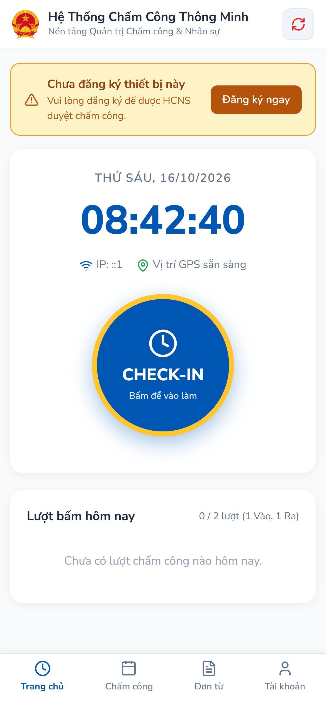

- **Trước khi bấm, bạn chỉ cần nhớ 2 điều**:
  - Điện thoại đã kết nối vào đúng **mạng Wifi của trung tâm Superbrain** (không dùng mạng 4G/5G cá nhân để chấm).
  - Điện thoại đã **Bật định vị vị trí (GPS)** ở chế độ chính xác.
- **Thao tác**:
  1. Mở trình duyệt trên điện thoại (Safari trên iPhone, Chrome trên Android).
  2. Vào trang web chấm công.
  3. Màn hình tự động kiểm tra và báo:
     - Tên Wifi: *Đúng Wifi Superbrain* ✅
     - Vị trí: *Nằm trong khuôn viên trường/cơ sở* ✅
  4. Bấm nút tròn to: **"CHECK-IN Bấm để vào làm"** (buổi sáng) hoặc **"CHECK-OUT"** (buổi chiều).
  5. Màn hình báo thành công ngay lập tức!

> [!TIP]
> **Khóa an toàn 30 phút chống bấm nhầm Giờ về**: Để bảo vệ bạn không bị lỡ tay bấm đúp hoặc bấm nhầm nút "Ra về" ngay khi vừa bấm "Vào làm", hệ thống sẽ tự động tạm khóa nút Ra về trong vòng 30 phút đầu tiên. Nút sẽ hiển thị `Đang trong ca làm việc`. Sau 30 phút, nút Ra về sẽ tự động mở lại bình thường.

---

## 2.3. Việc làm định kỳ: Xem lại ngày công và số ngày phép còn lại

Bạn có thể tự mình kiểm tra xem tháng này mình đã đi làm đủ bao nhiêu ngày mà không cần phải chờ đến cuối tháng hỏi phòng Nhân sự:

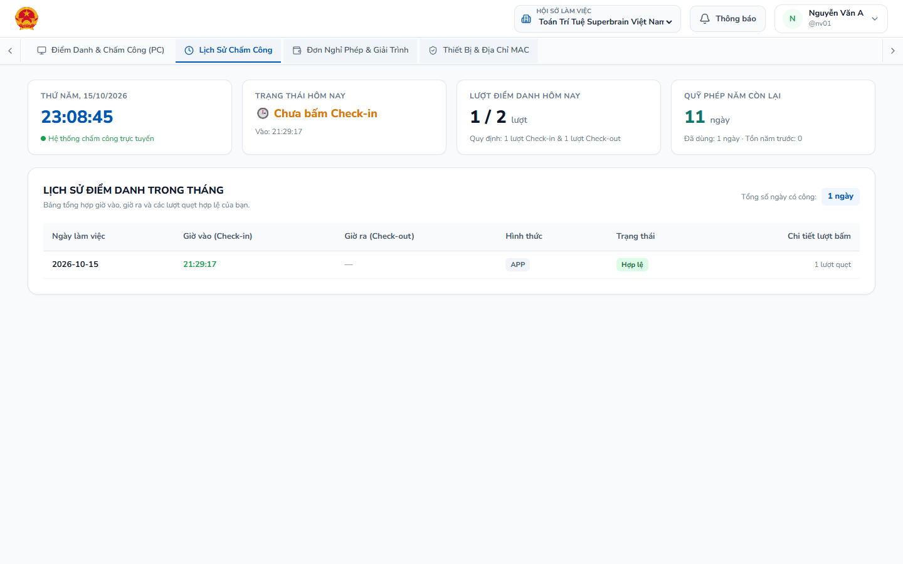

1. Bấm vào menu **"Lịch Sử Chấm Công"** (hoặc *Bảng công cá nhân*).
2. Chọn tháng cần xem (Ví dụ: Tháng 10/2026).
3. Màn hình hiển thị dạng lịch trực quan:
   - **Ngày màu xanh**: Đã đi làm đủ giờ (8 tiếng).
   - **Ngày màu vàng/cam**: Có đi trễ hoặc về sớm số phút cụ thể.
   - **Tổng số ngày đã đi làm**: Hiển thị rõ tổng ngày công trong tháng.
   - **Quỹ phép năm còn lại**: Góc trên màn hình luôn hiển thị bạn còn lại bao nhiêu ngày phép hưởng nguyên lương để bạn chủ động lên kế hoạch nghỉ ngơi.

---

## 2.4. Khi có việc đột xuất: Làm đơn xin nghỉ phép

Khi bạn có việc gia đình, bị ốm hoặc muốn nghỉ phép năm:

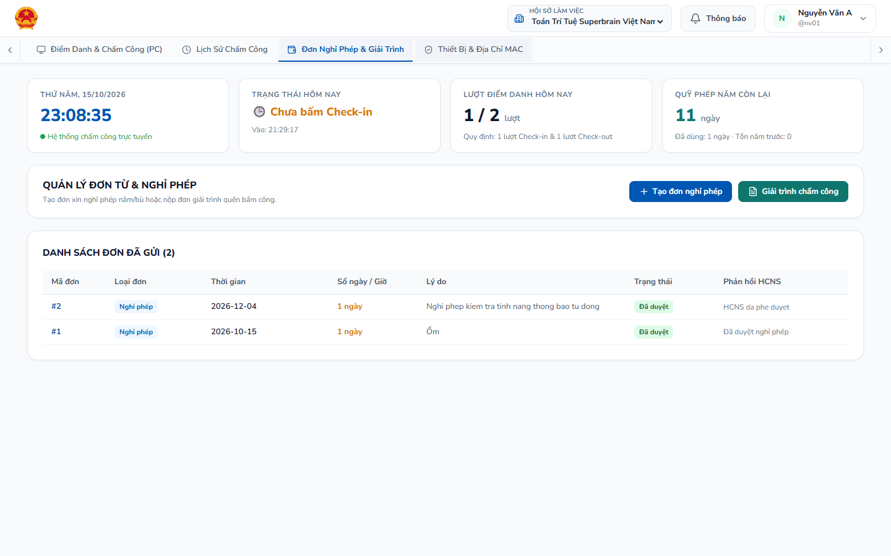

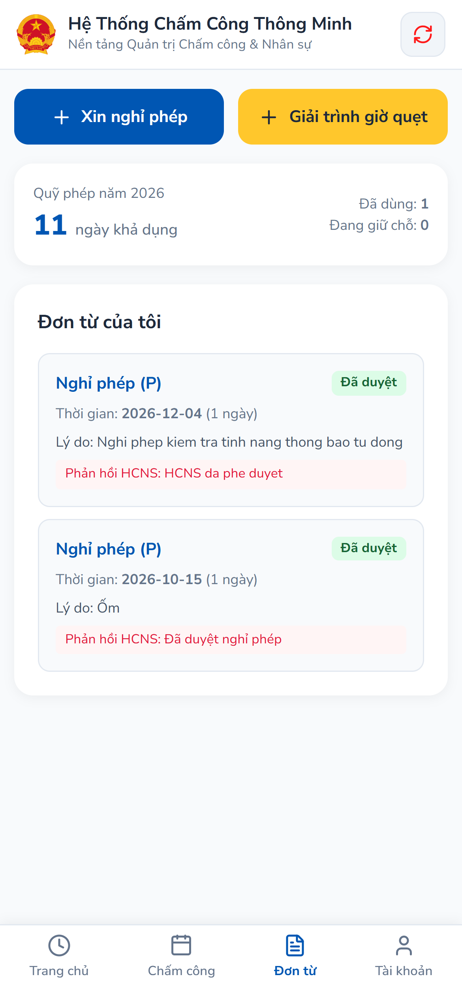

1. Vào mục **"Đơn Nghỉ Phép & Giải Trình"** -> Bấm nút **"Tạo đơn nghỉ phép"**.
2. Điền các mục rất dễ:
   - **Loại phép**: Chọn *Nghỉ phép năm*, *Nghỉ ốm* hoặc *Nghỉ việc riêng*.
   - **Thời gian nghỉ**: Chọn ngày bắt đầu và ngày kết thúc (có thể chọn nghỉ Cả ngày, Nửa ngày sáng hoặc Nửa ngày chiều).
   - **Lý do nghỉ**: Ghi ngắn gọn để Sếp nắm được (Ví dụ: *Em xin nghỉ phép về quê có việc gia đình*).
   - **Người nhận bàn giao công việc**: Chọn tên đồng nghiệp hỗ trợ lớp học/công việc trong lúc bạn vắng mặt (nếu có).
3. Bấm **"Gửi đơn"**. Đơn sẽ tự động chuyển đến tài khoản của Quản lý để duyệt.

---

## 2.5. Khi quên bấm giờ hoặc đi công tác ngoài: Làm đơn báo bổ sung công (giải trình)

Nếu hôm nay bạn có đi làm nhưng quên bấm máy tính lúc vào, hoặc máy tính bị mất điện, hoặc bạn được cử đi công tác bên ngoài:

1. Vào mục **"Đơn Nghỉ Phép & Giải Trình"** -> Bấm nút **"Giải trình chấm công"** (hoặc *Báo bổ sung giờ làm*).
2. Chọn loại bổ sung:
   - *Bổ sung giờ Vào làm*
   - *Bổ sung giờ Ra về*
   - *Bổ sung cả ngày*
3. Nhập **Giờ thực tế** bạn có mặt hoặc rời đi (Ví dụ: 08:30 sáng).
4. **Lý do**: Ghi rõ nguyên nhân (Ví dụ: *Sáng nay máy tính phòng học cập nhật hệ điều hành đến 9h mới mở được* hoặc *Đi họp đối tác tại Quận 1 theo phân công của Sếp*).
5. Có thể đính kèm ảnh minh chứng (ảnh giấy công tác, ảnh chụp màn hình máy tính) nếu cần.
6. Bấm **"Gửi đơn"**. Khi Quản lý bấm duyệt, hệ thống sẽ tự động bù đủ công ngày hôm đó cho bạn mà không bị trừ lương hay tính vắng mặt!

---

## 2.6. Dành cho nhân sự thử việc & bán thời gian: Đăng ký lịch làm việc

### A. Đối tượng cần đăng ký lịch làm việc:
- 🆕 **Nhân sự Thử Việc (Probationary Staff)**: Trong thời gian thử việc hoặc tiếp nhận công việc mới, lịch làm việc của bạn được đăng ký theo kế hoạch đào tạo, hướng dẫn của Quản lý để hệ thống có căn cứ đối chiếu chấm công và đánh giá chuyên cần khi kết thúc thử việc.
- ⏱️ **Nhân sự Bán Thời Gian (Part-time)**: Giáo viên hoặc trợ giảng đăng ký ca dạy, buổi làm việc theo tuần hoặc tháng.
- 🏠 **Nhân sự Làm Việc Tại Nhà (Remote)**: Đăng ký các ngày làm việc từ xa để hệ thống tự động ghi nhận công.

*(Lưu ý: Nhân viên chính thức làm việc toàn thời gian Full-time cố định tại văn phòng/cơ sở sẽ đi làm theo ca chuẩn mặc định của công ty, không cần đăng ký từng ngày).*

### B. Các bước thao tác trên màn hình Lịch làm việc:
1. Vào menu **"Lịch làm việc của tôi"** (hoặc biểu tượng Lịch trên cổng cá nhân).
2. Quan sát **Lịch tháng trực quan** 7 cột từ Thứ Hai đến Chủ Nhật (hiển thị rõ ngày làm việc chuẩn, nửa ngày Thứ Bảy, ngày nghỉ tuần và ngày lễ công ty).
3. **Chọn ngày cần đăng ký**: Nhấp chọn từng ngày hoặc dùng tính năng **"Chọn nhiều ngày cùng lúc (Batch Select)"** để chọn nhanh các ngày trong tuần/tháng.
4. **Chọn ca làm việc**: Chọn *Cả ngày (Full-time)*, *Ca sáng (Morning)* hoặc *Ca chiều (Afternoon)* kèm ghi chú công việc nếu có.
5. Nhấn nút xanh **"Đăng ký lịch làm việc"**. Ngày đăng ký sẽ chuyển sang màu xanh trên lịch.

> [!IMPORTANT]
> ### 3 NGUYÊN TẮC BẮT BUỘC ĐỂ KHÔNG BỊ MẤT CÔNG THỬ VIỆC
> 1. ⚠️ **Bắt buộc phải đăng ký trước**: Phải đăng ký trước ngày làm thực tế. Hệ thống **chặn hoàn toàn việc đăng ký lùi ngày đã qua**.
> 2. 🛡️ **Ngày ngoài lịch không bị tính vắng không phép**: Những ngày bạn không đăng ký lịch được xem là ngày nghỉ tự nhiên ngoài lịch, **hoàn toàn không cần làm đơn giải trình và không bị tính là vắng mặt không phép (KP)**.
> 3. 💡 **Tính công chuẩn xác theo ngày làm thực tế**: Bạn đi làm và bấm điểm danh thực tế bao nhiêu ngày thì hệ thống tính đủ bấy nhiêu ngày công. Nếu Quản lý phân công làm thêm ngày ngoài lịch thì hệ thống vẫn ghi nhận đủ công thực tế cho bạn!

---

## 2.7. Xem thông báo phản hồi từ Quản lý và Nhân sự

Ngay góc trên bên phải màn hình (cạnh tên tài khoản của bạn) có biểu tượng hình chiếc **Chuông (🔔)**:
- Khi Sếp đã bấm **Duyệt đơn nghỉ phép** hoặc **Duyệt đơn bổ sung công**, chuông sẽ hiện chấm đỏ.
- Nhấp vào chuông để đọc phản hồi (Nếu Sếp từ chối, chuông sẽ hiển thị kèm lý do để bạn nắm rõ).

---

# CHƯƠNG 3: HƯỚNG DẪN DÀNH CHO TRƯỞNG BỘ PHẬN / QUẢN LÝ CƠ SỞ

Tài liệu này dành cho Quản lý cơ sở và Trưởng bộ phận. Các tính năng được sắp xếp theo trình tự công việc từ đầu ngày đến cuối tháng:

```
[MỖI SÁNG] Xem ai đã đến, ai vắng hôm nay
    ⬇
[TRONG NGÀY] Duyệt Đơn xin nghỉ phép của nhân viên
    ⬇
[TRONG NGÀY] Duyệt Đơn báo bổ sung công của nhân viên
    ⬇
[CUỐI THÁNG] Rà soát lại công cả đội ngũ trước khi chốt lương
```

---

## 3.1. Đầu ngày: Xem danh sách nhân viên đi làm hôm nay

Vào mỗi buổi sáng, Quản lý có thể mở trang chủ để nắm bắt tình hình đi làm của toàn bộ đội ngũ trong vài giây:
1. Đăng nhập vào phần mềm bằng tài khoản Quản lý.
2. Tại màn hình chính (Trang tổng quan), bạn sẽ thấy các con số rõ ràng:
   - **Số người đã có mặt**: Danh sách các bạn đã bấm điểm danh sáng nay.
   - **Số người đang nghỉ phép**: Các bạn đã xin nghỉ phép hợp lệ từ trước.
   - **Số người chưa thấy có mặt**: Các bạn chưa bấm điểm danh (để quản lý kịp thời liên hệ nhắc nhở hoặc bố trí giáo viên dạy thay nếu có lớp).

---

## 3.2. Khi có đơn gửi lên: Duyệt đơn xin nghỉ phép của nhân viên

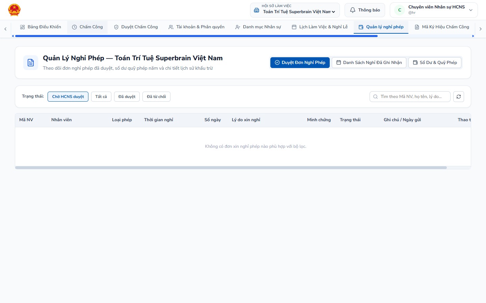

1. Vào menu **"Quản lý Nghỉ phép"** -> Chọn mục **"Chờ phê duyệt"**.
2. Danh sách hiển thị toàn bộ các đơn xin nghỉ phép của các nhân viên thuộc quyền quản lý của bạn.
3. Xem các thông tin:
   - Tên nhân viên, ngày xin nghỉ, lý do nghỉ.
   - Số ngày phép năm còn lại của nhân viên đó.
   - Kế hoạch bàn giao công việc hoặc người trực thay.
4. Thao tác:
   - Bấm **"Duyệt"**: Đơn được chấp thuận ngay, hệ thống tự động ghi nhận ngày nghỉ có phép cho nhân viên.
   - Bấm **"Từ chối"**: Bắt buộc nhập dòng *Lý do từ chối* (Ví dụ: *Hôm đó cơ sở có kỳ thi sát hạch, đề nghị dời lịch sang tuần sau*). Nhân viên sẽ nhận được thông báo giải thích này ngay trên chuông điện thoại.

---

## 3.3. Khi có đơn gửi lên: Duyệt đơn báo bổ sung công của nhân viên

Khi nhân viên quên bấm giờ hoặc đi ra ngoài gặp khách hàng và gửi đơn báo bổ sung công:

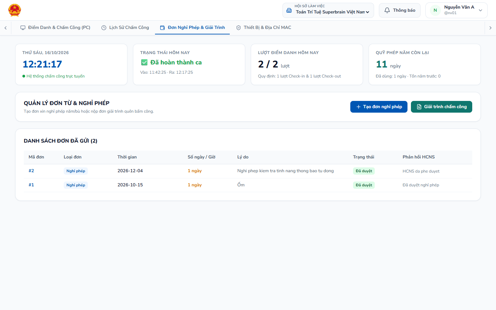

1. Vào menu **"Duyệt Bổ Sung Công"** (hoặc *Duyệt Giải Trình*).
2. Xem thông tin: Tên bạn nhân viên, ngày bị thiếu công, giờ thực tế bạn có mặt và lý do bạn giải trình.
3. Đối chiếu với thực tế làm việc của bạn đó.
4. Bấm **"Chấp thuận"** hoặc **"Từ chối"**.
   - Khi bạn bấm Chấp thuận, ngày công đó sẽ được **đánh dấu an toàn**. Bộ phận Nhân sự khi bấm tính công cuối tháng sẽ không thể ghi đè làm mất công của nhân viên.

---

## 3.4. Cuối tháng: Rà soát lại công của toàn bộ bộ phận trước khi gửi Nhân sự

Trước ngày chốt công hàng tháng (khoảng ngày 25):
1. Quản lý vào xem bảng tổng hợp công của cả bộ phận.
2. Kiểm tra xem còn đơn xin nghỉ hay đơn giải trình nào của nhân viên còn tồn đọng ở trạng thái "Chờ duyệt" hay không.
3. Xử lý duyệt dứt điểm toàn bộ đơn từ để bộ phận Nhân sự có đầy đủ số liệu chính xác nhất tính lương cho nhân viên đúng hạn.

---

# CHƯƠNG 4: HƯỚNG DẪN DÀNH CHO BỘ PHẬN NHÂN SỰ (HR / TÍNH LƯƠNG)

Tài liệu này dành riêng cho Chuyên viên Nhân sự, C&B phụ trách tính toán ngày công và xuất bảng lương.

Toàn bộ quy trình thủ công phức tạp trước đây đã được thay thế bằng **Quy trình Tính công Tự động 1-Lần-Bấm**, sắp xếp từ công việc duy trì hàng ngày đến khâu chốt công cuối tháng:

```
[TRONG THÁNG] Rà soát các lượt bấm lỗi & Quản lý ngày nghỉ toàn công ty
    ⬇
[CUỐI THÁNG - BƯỚC 1] Bấm nút Tính công tự động (Chỉ 1 lần bấm)
    ⬇
[CUỐI THÁNG - BƯỚC 2] Nạp thêm file từ máy bấm vân tay (Nếu có)
    ⬇
[CUỐI THÁNG - BƯỚC 3] Xem bảng công, sửa tay trực tiếp (Có nút Hoàn tác)
    ⬇
[CUỐI THÁNG - BƯỚC 4] Chốt bảng công & Xuất file Excel gửi Kế toán
```

---

## 4.1. Hàng ngày / Trong tháng: Theo dõi các lượt bấm giờ bị báo lỗi để nhắc nhở

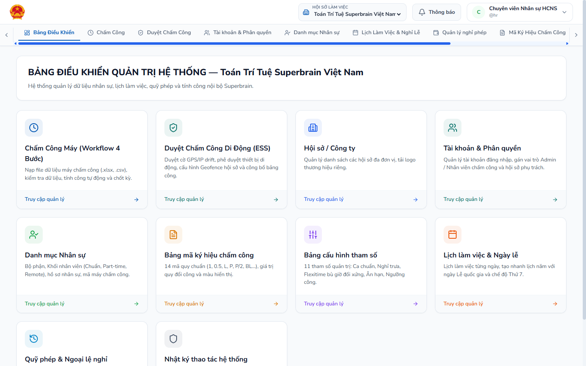

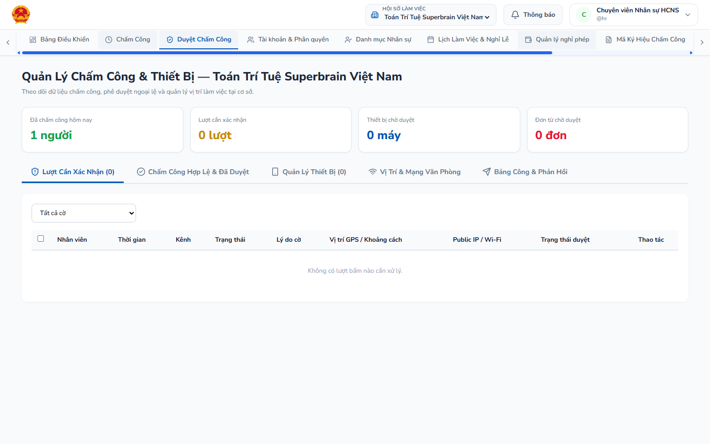

### Điểm cải tiến vượt trội giúp Nhân sự không bị ngợp việc:
- **Các lượt bấm HỢP LỆ (Đúng máy, đúng Wifi, đúng khuôn viên trường)**: Phần mềm **tự động xác nhận** và tự động gom vào bảng công. Nhân sự **KHÔNG CẦN** bấm duyệt từng lượt thủ công như trước nữa!
- **Các lượt KHÔNG HỢP LỆ (Bất thường)**: Sẽ được gom riêng vào bảng cảnh báo kèm lý do rõ ràng:
  - `Sai máy tính`: Bấm từ một máy tính lạ chưa khai báo.
  - `Sai Wifi`: Điện thoại đang bắt Wifi nhà dân bên cạnh hoặc bật 4G.
  - `Ngoài khuôn viên trường`: Điện thoại ở cách trung tâm quá xa.

### Cách xử lý:
1. Nhấp vào lượt bị cảnh báo để xem chi tiết giờ bấm và lý do.
2. Trao đổi nhanh với bạn nhân viên hoặc Quản lý cơ sở.
3. Nếu là sự cố khách quan chính đáng (Ví dụ: Cơ sở vừa thay bộ phát Wifi mới chưa kịp báo IT), Nhân sự bấm nút **"Chấp nhận đặc cách"** để ghi nhận giờ công cho bạn đó.

---

## 4.2. Trong tháng: Quản lý ngày nghỉ toàn công ty & Nạp danh sách nghỉ từ Excel

Giao diện Quản lý nghỉ phép của Nhân sự gồm 2 phần rõ ràng:

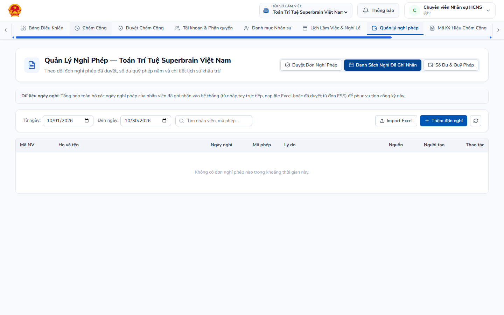

- **Phần 1: Duyệt Đơn Nghỉ Phép**: Danh sách đơn do nhân viên nộp lên (nhân sự có thể xem tiến độ duyệt của Quản lý hoặc duyệt thay nếu được phân công).
- **Phần 2: Danh Sách Nghỉ Toàn Công Ty (Ngoại lệ & Nạp Excel)**:
  - *Ngày nghỉ Lễ, Tết theo quy định nhà nước*: Hệ thống tự động ghi nhận ngày nghỉ có hưởng lương cho toàn thể nhân viên.
  - *Nghỉ sự kiện / Du lịch toàn công ty / Cơ sở sửa chữa*: Nhân sự bấm nút tạo mới để thêm ngày nghỉ chung cho cả công ty hoặc cho một cơ sở mà không cần nhân viên phải nộp đơn từng người.
  - *Nạp danh sách nghỉ hàng loạt từ Excel*: Nếu có sẵn danh sách nhân viên nghỉ phép từ file ngoài, chỉ cần bấm **"Import Danh Sách Nghỉ (Excel)"**, toàn bộ ngày nghỉ sẽ được nạp vào hệ thống chỉ trong 2 giây.

---

## 4.3. Cuối kỳ: Quy trình Tính công tự động 1-Lần-Bấm

Đến kỳ chốt công hàng tháng (khoảng ngày 25 hoặc cuối tháng), bạn không cần phải tính toán thủ công từng bước rườm rà.


### Thao tác chỉ với 1 lần bấm duy nhất:
1. Vào menu **"Chấm Công"**.
2. Chọn **Kỳ công cần tính** (Ví dụ: *Kỳ Tháng 11/2026: 26/10/2026 đến 25/11/2026*).
3. Nhấn nút xanh nổi bật: **"⚡ 1-Chạm: Tổng hợp & Tính công ngay"**.


4. **Phần mềm sẽ tự động làm hết mọi việc trong 2 giây**:
   - Tự gom toàn bộ giờ bấm hợp lệ từ máy tính và điện thoại của toàn bộ nhân viên.
   - Tự gộp toàn bộ các ngày đã có **Đơn giải trình bổ sung công** đã được Sếp duyệt.
   - Tự tích hợp toàn bộ các ngày **Nghỉ phép** và **Ngày nghỉ lễ toàn công ty**.
   - **Tự động chuyển thẳng Nhân sự sang màn hình Bảng Tính Công Chi Tiết (Grid)** với đầy đủ số liệu hoàn chỉnh, không bắt bạn phải bấm đi bấm lại!

---

## 4.4. Cuối kỳ: Nạp thêm dữ liệu từ máy bấm vân tay tại cửa (nếu có)

Nếu cơ sở của bạn vẫn đang sử dụng song song máy chấm công bấm vân tay hoặc nhận diện khuôn mặt gắn ở cửa ra vào:
1. Tại màn hình tính công, nhìn sang khung bên phải: **"Nạp bổ sung từ file máy chấm công (Tùy chọn)"**.
2. Kéo thả file Excel xuất ra từ máy bấm vân tay vào khung này.
3. Bấm **"Xác nhận Nạp & Gộp dữ liệu"**.
4. **Cơ chế gộp thông minh**: Phần mềm tự động gộp dữ liệu vân tay này chung với dữ liệu bấm trên máy tính/điện thoại của nhân viên. Nhân viên bấm ở đâu cũng đều được ghi nhận chuẩn xác mà không bị mất dữ liệu.

---

## 4.5. Cuối kỳ: Sửa công trực tiếp bằng tay & Nút Hoàn tác (Undo) nếu lỡ sửa nhầm

Sau khi phần mềm tự động tính toán xong, Nhân sự có toàn quyền kiểm tra và điều chỉnh trực tiếp các ô công đặc biệt:

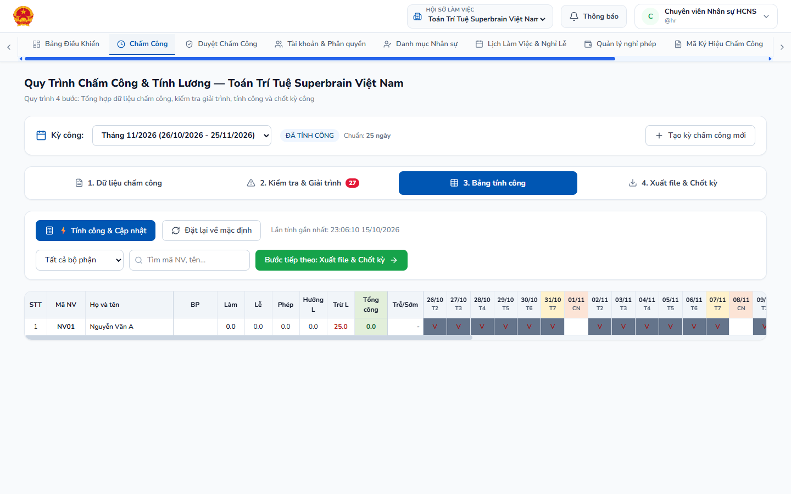

### Thao tác sửa tay cực nhanh:
1. Nhấp chuột vào ô công của nhân viên cần điều chỉnh (Ví dụ: Cột Ngày 15 của thầy Nam).
2. Gõ lại số giờ hoặc ký hiệu công mong muốn (Ví dụ: Đổi từ *0* thành *1.0* công).
3. Bấm Enter hoặc nhấp chuột ra ngoài để lưu.

> [!TIP]
> **Nút Hoàn tác (Undo) - Cứu nguy khi lỡ tay bấm nhầm**:
> - Nếu bạn lỡ tay nhập sai số liệu, hoặc lỡ tay bấm nhầm nút tính toán lại làm mất những ô vừa sửa tay:
> - Hãy nhìn ngay lên góc trên bên phải của bảng tính công, bấm vào nút **"↩️ Hoàn tác (Undo)"**.
> - Toàn bộ các số liệu bạn vừa sửa tay trước đó sẽ lập tức được lấy lại nguyên vẹn 100%!

---

## 4.6. Cuối kỳ: Chốt bảng công và Xuất file Excel gửi kế toán trả lương

1. Sau khi đã kiểm tra toàn bộ bảng công hoàn chỉnh và chuẩn xác.
2. Bấm nút **"Xuất Excel Bảng Công"**: Máy tính sẽ tải về file Excel hoàn chỉnh theo đúng biểu mẫu bảng lương chuẩn của Superbrain (đầy đủ số giờ công chuẩn, ngày phép năm, đi trễ, làm thêm).
3. Bấm nút **"🔒 Chốt Kỳ Công (Lock Period)"**:
   - Bảng công sẽ chuyển sang chế độ **Đóng băng an toàn (Chỉ xem)**.
   - Không ai có thể vô tình bấm sửa làm thay đổi số liệu nữa, bảo đảm an toàn tuyệt đối phục vụ việc thanh toán tiền lương và lưu trữ hồ sơ.

---

# CHƯƠNG 5: HƯỚNG DẪN DÀNH CHO QUẢN TRỊ VIÊN HỆ THỐNG (ADMIN)

Tài liệu này dành cho Quản trị viên (Admin / Phụ trách kỹ thuật). Các thao tác được sắp xếp từ khâu **thiết lập ban đầu khi triển khai** cho đến các **công việc hỗ trợ hàng ngày**:

```
[BƯỚC 1] Khai báo Cơ sở & Cài đặt Vị trí, Tên Wifi
    ⬇
[BƯỚC 2] Cài đặt Quy định giờ làm việc chuẩn
    ⬇
[BƯỚC 3] Tạo tài khoản và phân quyền cho Nhân sự mới
    ⬇
[HỖ TRỢ HÀNG NGÀY] Mở khóa khi nhân viên đổi máy & Đổi lại mật khẩu
    ⬇
[BẢO MẬT] Cài đặt nhận diện thương hiệu & Theo dõi nhật ký sử dụng
```

---

## 5.1. Cài đặt ban đầu: Tạo danh sách Cơ sở / Chi nhánh mới

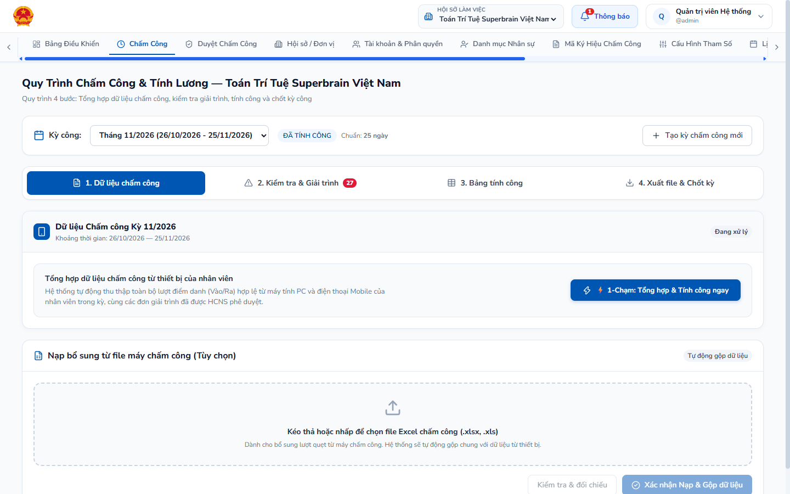

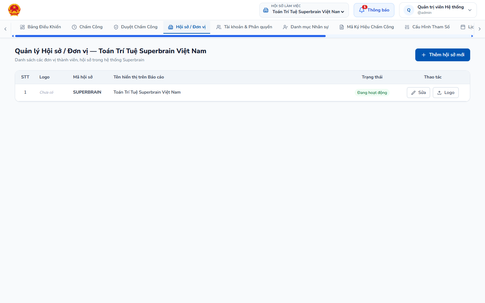

1. Đăng nhập bằng tài khoản Quản trị viên (`admin`).
2. Vào menu **"Hội sở / Đơn vị"** -> Bấm nút **"Thêm hội sở mới"**.
3. Điền thông tin:
   - **Mã đơn vị**: Ví dụ `SUPERBRAIN_Q1`, `SUPERBRAIN_THU_DUC`.
   - **Tên cơ sở**: Ví dụ *Toán Trí Tuệ Superbrain - Cơ sở Quận 1*.
   - **Địa chỉ**: Nhập địa chỉ cụ thể của cơ sở.

---

## 5.2. Cài đặt ban đầu: Cài đặt Vị trí và Tên Wifi cho cơ sở

Đây là cài đặt quan trọng nhất để giáo viên có thể bấm điểm danh bằng điện thoại khi đến cơ sở:

1. Tại màn hình chi tiết của cơ sở đó, tìm đến mục **Cài đặt Chấm công Điện thoại**.
2. **Cài đặt Vị trí của trường (Bản đồ)**:
   - Mở bản đồ Google Maps, tìm đúng địa chỉ trung tâm, nhấp chuột phải chọn sao chép tọa độ (gồm Vĩ độ và Kinh độ).
   - Dán tọa độ vào ô tương ứng trên phần mềm.
   - **Khoảng cách cho phép (Bán kính)**: Nhập từ `50` đến `100` mét (khoảng cách này giúp các bạn ở trong lớp học kín, hành lang hoặc tầng lầu vẫn bắt được sóng vị trí tốt).
3. **Cài đặt Tên mạng Wifi của trường**:
   - Nhập chính xác tên các mạng Wifi phát sóng tại trung tâm mà giáo viên được dùng (Ví dụ: `Superbrain_Office`, `Superbrain_GiaoVien`).
   - Có thể thêm nhiều tên Wifi nếu trung tâm có nhiều tầng lầu.
4. Bấm **"Lưu thay đổi"**.

---

## 5.3. Cài đặt ban đầu: Cài đặt Quy định giờ làm việc

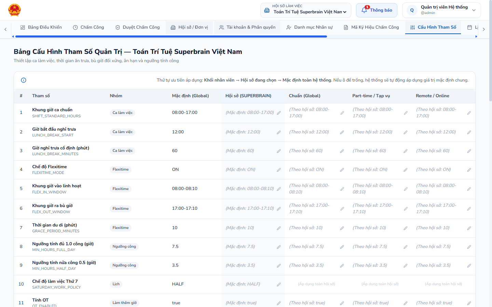

1. Vào menu **"Cấu Hình Tham Số"**.
2. Tùy chỉnh các quy định cho phù hợp với nội quy công ty:
   - **Giờ vào làm buổi sáng**: Ví dụ 08:30.
   - **Giờ kết thúc buổi chiều**: Ví dụ 17:30.
   - **Giờ nghỉ trưa**: Ví dụ từ 12:00 đến 13:30 (phần mềm tự động trừ 1.5 tiếng nghỉ trưa khi tính giờ làm việc thực tế).
   - **Số phút cho phép đi trễ**: Ví dụ cho phép trễ `5` hoặc `10` phút không bị tính phạt.
   - **Quy định ngày Thứ Bảy**: Chọn làm cả ngày, làm nửa ngày hoặc nghỉ cả ngày.
3. Bấm **"Lưu cấu hình"**. Toàn bộ hệ thống sẽ áp dụng quy định mới ngay tức thì.

---

## 5.4. Khi có nhân sự mới: Tạo tài khoản và phân quyền vai trò

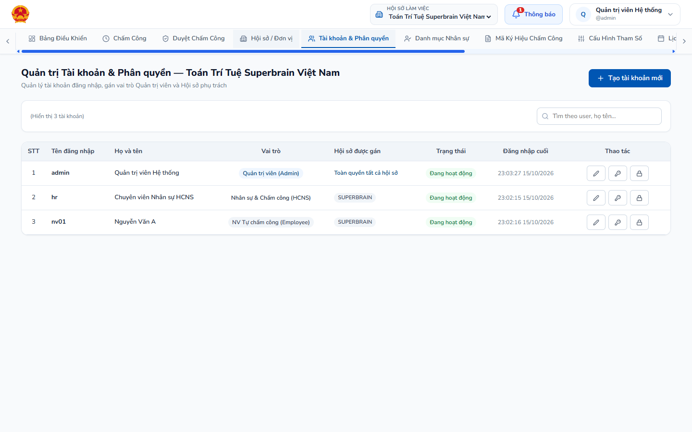

1. Vào menu **"Tài khoản & Phân quyền"** -> Bấm **"Thêm người dùng mới"**.
2. Nhập thông tin:
   - **Tên đăng nhập**: Thường là Mã nhân viên (Ví dụ: `nv02`, `nv03`) hoặc Email.
   - **Họ và tên**: Họ tên đầy đủ của nhân sự.
   - **Mật khẩu ban đầu**: Ví dụ `Superbrain@123`.
   - **Cơ sở làm việc**: Chọn đúng chi nhánh mà nhân sự này trực thuộc.
3. **Chọn vai trò (Phân quyền)**:
   - `Nhân viên (Employee)`: Dành cho giáo viên và nhân viên thông thường (chỉ được chấm công cá nhân, xem công của mình, làm đơn xin nghỉ).
   - `Quản lý (Manager)`: Dành cho Trưởng phòng, Quản lý cơ sở (có thêm quyền xem quân số và duyệt đơn nghỉ phép, đơn giải trình của cấp dưới).
   - `Nhân sự (HR)`: Dành cho bộ phận nhân sự (toàn quyền sử dụng tính công, duyệt chấm công, xuất bảng lương).
   - `Quản trị viên (Admin)`: Quản lý kỹ thuật toàn hệ thống.
4. Bấm **"Lưu tài khoản"**.

---

## 5.5. Hỗ trợ hàng ngày: Đổi mật khẩu giúp nhân viên

Khi nhân viên quên mật khẩu hoặc nhập sai nhiều lần:
1. Vào menu **"Tài khoản & Phân quyền"**.
2. Tìm tên của nhân viên trong danh sách.
3. Bấm vào nút **"Đặt lại mật khẩu"**.
4. Gõ mật khẩu mới dễ nhớ và gửi lại cho nhân viên đăng nhập.

---

## 5.6. Hỗ trợ hàng ngày: Mở khóa đổi máy khi nhân viên mua điện thoại/máy tính mới

Để chống gian lận, mỗi nhân viên chỉ được dùng đúng 1 máy tính hoặc 1 điện thoại. Khi nhân viên mua điện thoại mới hoặc cơ sở đổi máy tính làm việc:
1. Nhân viên khi dùng máy mới sẽ thấy thông báo: *"Tài khoản của bạn đã được gắn với thiết bị khác"*.
2. Nhân viên sẽ báo cho Admin hỗ trợ mở khóa.
3. Admin vào menu **"Duyệt Chấm Công"** -> Chọn tab **"Quản Lý Thiết Bị"**.
4. Tìm tên của nhân viên đó.
5. Bấm nút **"Hủy liên kết (Mở khóa thiết bị)"**.
6. Ngay sau khi Admin bấm, liên kết cũ sẽ được xóa bỏ. Nhân viên chỉ cần mở máy mới lên và bấm nút "Đăng ký thiết bị này" là xong ngay trong 10 giây!

---

## 5.7. Cài đặt thương hiệu & Theo dõi nhật ký hệ thống

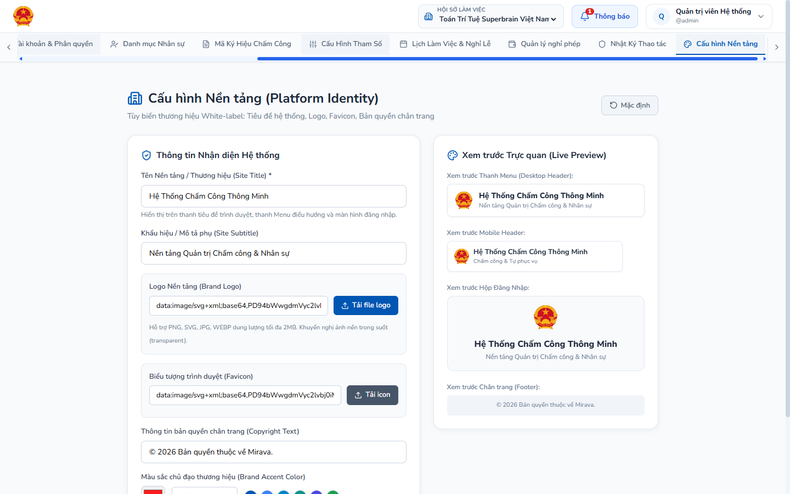

- **Cài đặt Thương hiệu & Logo**: Vào menu *Cấu hình Nền tảng* để tải logo Superbrain lên, đổi tiêu đề trang web hoặc chỉnh sửa dòng chữ bản quyền chân trang. Mọi máy tính đang mở phần mềm sẽ đổi logo ngay lập tức.
- **Theo dõi Nhật ký hoạt động**: Vào menu *Nhật Ký Thao Tác* để xem lịch sử minh bạch: Ai đã đăng nhập vào lúc nào, ai đã bấm duyệt đơn xin nghỉ, ai đã sửa tay vào bảng công của nhân viên. Sổ nhật ký này được lưu trữ tự động, không ai có thể tự ý sửa xóa, bảo đảm minh bạch 100%.

---

# CHƯƠNG 6: 10 ĐIỀU QUAN TRỌNG NHẤT BẮT BUỘC PHẢI NHỚ

> [!WARNING]
> ### 10 ĐIỀU CỐT LÕI TOÀN THỂ NGƯỜI DÙNG CẦN GHI NHỚ ĐỂ KHÔNG BỊ PHÁT SINH LỖI
> 
> 1. **MỘT NGƯỜI - MỘT MÁY**: Tuyệt đối không cho đồng nghiệp mượn máy tính hoặc điện thoại của mình để bấm giờ hộ. Hệ thống nhận diện đúng 1 thiết bị cho 1 người; nếu người khác đăng nhập vào máy của bạn thì hệ thống sẽ từ chối ngay.
> 
> 2. **CHẤM CÔNG MÁY TÍNH CỰC KỲ ĐƠN GIẢN**: Khi ngồi máy tính bàn ở cơ sở, máy tính đã được lưu nhận diện. Bạn không cần bật định vị vị trí và không cần bận tâm về Wifi.
> 
> 3. **CHẤM CÔNG ĐIỆN THOẠI CẦN BẬT ĐỊNH VỊ VÀ WIFI**: Bắt buộc điện thoại phải kết nối vào đúng mạng Wifi của cơ sở Superbrain và bật định vị vị trí (GPS) trước khi bấm. Tuyệt đối không dùng mạng 4G/5G cá nhân để chấm công.
> 
> 4. **GIAO DIỆN TỰ ĐỘNG KHÓA NÚT ĐỂ TRÁNH BẤM NHẦM**: Khi đang mở bằng máy tính, nút đăng ký điện thoại sẽ tự khóa. Khi mở bằng điện thoại, nút máy tính chỉ để xem. Bạn chỉ cần bấm đăng ký trên chính thiết bị mình đang cầm.
> 
> 5. **KHÓA AN TOÀN 30 PHÚT CHỐNG BẤM NHẦM GIỜ VỀ**: Sau khi bấm Vào làm buổi sáng, nút Ra về sẽ tạm khóa trong 30 phút để tránh bạn lỡ tay bấm nhầm. Sau 30 phút nút sẽ mở lại bình thường.
> 
> 6. **CÁC LƯỢT BẤM ĐÚNG TỰ ĐỘNG ĐƯỢC CHẤP THUẬN**: Nhân sự không cần tìm nút duyệt cho các lượt quẹt thẻ đúng. Phần mềm tự động đưa vào bảng công. Nhân sự chỉ cần rà soát các trường hợp bị báo lỗi.
> 
> 7. **ĐƠN BỔ SUNG CÔNG ĐƯỢC BẢO VỆ TUYỆT ĐỐI**: Khi Quản lý đã duyệt đơn báo bổ sung công cho nhân viên, dù Nhân sự có bấm tính công lại bao nhiêu lần thì ngày công đó vẫn được giữ nguyên vẹn, không bao giờ bị mất.
> 
> 8. **DÙNG NÚT HOÀN TÁC (UNDO) KHI LỠ SỬA NHẦM**: Nếu Nhân sự lỡ tay sửa nhầm một ô công hoặc lỡ bấm nhầm tính lại, chỉ cần bấm nút **"↩️ Hoàn tác"** ở góc trên bên phải bảng công là mọi số liệu cũ sẽ lập tức quay trở lại!
> 
> 9. **NỘP ĐƠN NGHỈ & ĐƠN BỔ SUNG CÔNG TRƯỚC NGÀY 25**: Nhân viên cần hoàn tất việc gửi đơn xin nghỉ phép và đơn báo bổ sung công trước ngày 25 hàng tháng để Sếp kịp duyệt trước khi Nhân sự chốt lương.
> 
> 10. **CHỐT BẢNG CÔNG ĐỂ BẢO VỆ KẾT QUẢ**: Sau khi Nhân sự hoàn tất việc tính toán và đối soát, bắt buộc phải bấm nút **"🔒 Chốt Kỳ Công"** để đóng băng số liệu, không cho phép ai chỉnh sửa thêm.

---

# CHƯƠNG 7: GIẢI ĐÁP THẮC MẮC & XỬ LÝ NHANH CÁC TÌNH HUỐNG THƯỜNG GẶP

### ❓ Câu hỏi 1: Tôi bấm điểm danh trên điện thoại nhưng máy báo "Không tìm thấy vị trí" hoặc "Ở quá xa cơ sở"?
- **Nguyên nhân**:
  1. Bạn chưa bấm "Cho phép" khi trình duyệt hỏi quyền truy cập vị trí.
  2. Điện thoại đang bật chế độ định vị tiết kiệm pin.
  3. Bạn đang đứng ở góc phòng quá kín khiến sóng định vị chưa bắt kịp.
- **Cách xử lý**:
  - Vào *Cài đặt* của điện thoại -> *Quyền riêng tư* -> *Dịch vụ định vị* -> Chọn trình duyệt (Safari hoặc Chrome) -> Bật **"Cho phép khi dùng"** và bật **"Vị trí chính xác"**.
  - Mở ứng dụng Bản đồ (Google Maps) trên điện thoại lên xem chấm xanh đã chỉ đúng vị trí trường chưa, sau đó quay lại trang web bấm điểm danh lại.

---

### ❓ Câu hỏi 2: Tôi chấm công trên điện thoại nhưng hệ thống báo "Sai mạng Wifi"?
- **Nguyên nhân**: Điện thoại đang bật mạng di động 4G/5G hoặc đang bắt vào sóng Wifi nhà dân xung quanh.
- **Cách xử lý**: Vào Cài đặt Wifi trên điện thoại, chọn kết nối vào đúng mạng Wifi của trung tâm Superbrain.

---

### ❓ Câu hỏi 3: Tôi vừa mua điện thoại mới (hoặc vừa đổi máy tính), khi bấm đăng ký thì máy báo lỗi "Tài khoản đã gắn với thiết bị khác"?
- **Nguyên nhân**: Phần mềm vẫn đang nhớ thiết bị cũ để bảo mật cho bạn.
- **Cách xử lý**: Bạn chỉ cần nhắn tin cho phòng Nhân sự hoặc Admin nhờ: *"Mở khóa thiết bị giúp em"*. Sau khi Admin bấm mở khóa (mất 5 giây), bạn mở máy mới lên bấm "Đăng ký thiết bị này" là dùng bình thường.

---

### ❓ Câu hỏi 4: Đơn xin nghỉ phép của tôi đã gửi rồi nhưng Sếp bảo chưa thấy?
- **Nguyên nhân**: Bạn mới lưu nháp mà chưa bấm nút "Gửi đơn", hoặc mạng bị ngắt quãng lúc gửi.
- **Cách xử lý**: Vào mục *Lịch sử đơn từ* kiểm tra: Nếu đơn đang hiện chữ vàng `Chờ duyệt` là đã gửi thành công, bạn nhắn Sếp vào mục *Quản lý nghỉ phép -> Chờ phê duyệt* để bấm duyệt giúp bạn. Nếu đang hiện `Bản nháp`, bạn mở đơn ra và bấm **"Gửi đơn"**.

---

### ❓ Câu hỏi 5: Nhân sự lỡ tay sửa nhầm một số ô trên bảng công hoặc bấm nhầm tính lại thì làm thế nào?
- **Cách xử lý**: Cực kỳ đơn giản! Nhìn lên góc trên bên phải của bảng tính công, bấm ngay vào nút **"↩️ Hoàn tác (Undo)"**. Toàn bộ các giá trị bạn vừa sửa tay trước đó sẽ lập tức xuất hiện trở lại đầy đủ như cũ!

---

*(Tài liệu được phát hành và quản lý bởi Ban Quản Lý Dự Án Hệ Thống Chấm Công Superbrain - Lưu hành nội bộ)*
